<div align="center">

# 🎙️ VoiceBridge

**Local AI Video Dubbing with Accent-Free Voice Cloning, Prosody Transfer & Subtitles**

[](https://www.python.org/)
[](https://pytorch.org/)
[](https://gradio.app/)
[](#supported-languages)
[](LICENSE)

Translate any video into another language and dub it in the **original speaker's cloned voice** — preserving background music, timing, emotion, and natural native pronunciation. 100% local and open-source.

</div>

---

## ✨ Key Features

- **Accent-Free Voice Cloning** — Decouples native pronunciation (`Silero TTS v5` for Russian, `XTTS v2` with pitch-matched native anchors for 17 other languages) from speaker identity (`Seed-VC` with `CAMP++` timbre embeddings and `BigVGAN v2`), eliminating foreign accents while keeping the original speaker's timbre.
- **Background Music & SFX Preservation** — Separates vocals from ambient sound and music via `Demucs (htdemucs)` so only speech is replaced, with optional ducked voice-over or vocal-only modes.
- **Exact Timing & Prosody Sync** — Analyzes original pitch (`F0`), loudness envelope, shouting/emphasis, and segment pacing to fit dubbed speech naturally into the original timeline without drifting or clipping.
- **Interactive Transcript & Translation Editor** — Review and edit timestamps, source transcriptions, and translations directly in the UI before synthesis.
- **Flexible Video Subtitles** — Exports `.srt` files for both original and translated tracks, and optionally renders **burned-in ASS subtitles** (auto-scaled for `16:9` landscape and `9:16` vertical videos) or **embedded soft subtitle tracks** (`mov_text`) directly inside the MP4.
- **Direct URL Ingestion** — Upload local video files or paste URLs from YouTube, TikTok, and other platforms supported by `yt-dlp`.
- **6 GB VRAM Friendly Architecture** — Runs heavy GPU stages (`Demucs`, `Whisper`, `NLLB-200`, `XTTS/Silero`, `Seed-VC`) in isolated subprocesses with `bfloat16` optimization and staged memory release, keeping the UI process at `0 MB` idle VRAM.
- **Web UI & Native Desktop App** — Launch in your browser (`app.py`) or as a standalone window (`desktop.py` via `pywebview`).

---

## 🧠 Architecture & Pipeline

```mermaid
flowchart LR
    A["Video File / URL<br/>(yt-dlp + FFmpeg)"] --> B["Demucs htdemucs<br/>Vocals / Background"]
    B --> C["Whisper large-v3<br/>Speech-to-Text"]
    C --> D["NLLB-200 1.3B<br/>Translation"]
    D --> E["Interactive UI<br/>Edit Text & Timing"]
    E --> F["Silero v5 / XTTS v2<br/>Native Accent-Free TTS"]
    F --> G["Seed-VC + CAMP++<br/>Timbre Transfer"]
    G --> H["Prosody & Timing<br/>Alignment"]
    H --> I["FFmpeg Mix +<br/>Subtitles (ASS / SRT)"]
```



### Models & Tech Stack

| Stage | Model / Library | License |
| :--- | :--- | :--- |
| **Speech Recognition** | [faster-whisper](https://github.com/SYSTRAN/faster-whisper) (`Whisper large-v3`) | MIT |
| **Machine Translation** | [NLLB-200 Distilled 1.3B](https://huggingface.co/facebook/nllb-200-distilled-1.3B) (CTranslate2 FP16) | CC-BY-NC 4.0 |
| **Native Speech Synthesis** | [Silero TTS v5](https://github.com/snakers4/silero-models) (Russian) / [Coqui XTTS v2](https://github.com/idiap/coqui-ai-TTS) | MIT / CPML |
| **Voice Timbre Conversion** | [Seed-VC](https://github.com/Plachta/Seed-VC) (`DiT` + `BigVGAN v2` + `CAMP++`) | MIT / Apache 2.0 |
| **Audio Source Separation** | [Demucs (`htdemucs`)](https://github.com/adefossez/demucs) | MIT |
| **Interface & Desktop Shell** | [Gradio 5](https://gradio.app/) + [pywebview](https://pywebview.flowrl.com/) | Apache 2.0 / BSD |

---

## 🌍 Supported Languages

- **18 Target Dubbing Languages:**  
  English, Russian, German, French, Spanish, Italian, Portuguese, Polish, Czech, Slovak *(with custom Slovak phonetic & numeral adaptation)*, Dutch, Turkish, Hungarian, Arabic, Chinese, Japanese, Korean, Hindi.
- **35+ Source Languages:**  
  Automatic language detection via Whisper `large-v3` (including Ukrainian, Belarusian, Swedish, Finnish, Danish, Norwegian, Greek, Hebrew, Romanian, Bulgarian, Serbian, Croatian, Vietnamese, Thai, Indonesian, Persian, Kazakh, and all target languages above).

---

## 🚀 Installation

### Prerequisites

- **Python 3.10 or 3.11**
- **FFmpeg** available in `PATH` (`ffmpeg -version`)
- **NVIDIA GPU** with CUDA 12.x and **≥ 6 GB VRAM** recommended (CPU fallback is supported but significantly slower)

### Option 1: One-Click Setup (Windows)

```bat
git clone https://github.com/DmytroZam/VoiceBridge.git
cd VoiceBridge
install.bat
```

### Option 2: Manual Setup (Windows / Linux / macOS)

```bash
git clone https://github.com/DmytroZam/VoiceBridge.git
cd VoiceBridge

python -m venv .venv

# Windows:
.venv\Scripts\activate
# Linux / macOS:
source .venv/bin/activate

pip install -U pip wheel setuptools
pip install -r requirements.txt
pip install torch==2.6.0 torchaudio==2.6.0 --index-url https://download.pytorch.org/whl/cu124
```

> **Note:** On the first run, model weights (`Whisper large-v3`, `NLLB-200`, `Demucs`, `XTTS v2` / `Silero v5`, and `Seed-VC`) are downloaded automatically and cached locally. Subsequent runs work fully offline.

---

## 🎬 Usage

### Launch the App

- **Web Interface** (`http://127.0.0.1:7860`):
  ```bat
  run.bat
  # or: python app.py
  ```
- **Desktop Application** (native standalone window):
  ```bat
  run_desktop.bat
  # or: python desktop.py
  ```

### Dubbing Workflow

1. **Load Video** — Upload a video file or paste a supported video URL, then pick the source language (or leave *Auto-detect*) and target language.
2. **① Transcribe & Translate** — Extracts vocals, transcribes speech, and translates every segment into an editable table. Fix any names, phrasing, or timestamps if needed.
3. **② Dub with Original Voice** — Synthesizes accent-free speech, clones the speaker's timbre via Seed-VC, aligns timing & prosody, mixes with background audio, and exports the final `.mp4`, standalone `.wav`, and `.srt` subtitles.

> Use **⚡ Run All** to run both stages end-to-end in one click. All final outputs are saved to `outputs/` and intermediate workspace files to `work/`.

### Subtitle Options

Choose how subtitles are included via the **Subtitles in Video** selector:
- **Off (SRT files only)** — Clean video + downloadable original & translated `.srt` files.
- **Burned-in: Translation** — Hardcodes translated subtitles directly onto the video (adaptive styling for portrait and landscape videos).
- **Burned-in: Original** — Hardcodes source-language subtitles onto the video.
- **Embedded track (soft SRT)** — Muxes toggleable `mov_text` subtitle tracks directly into the MP4 container.

### Tips for Best Results

- Keep **Demucs** and **Deep Voice Cloning (Seed-VC)** enabled for clean timbre transfer without background bleed.
- For multi-speaker videos, enable **Clone voice per segment individually** under *Advanced Settings*.
- Adjust **Preserve Intonation & Emotion** to control how strongly original pitch contours, emphasis, and volume dynamics are transferred.

---

## 📁 Project Structure

```text
VoiceBridge/
├── app.py                  # Gradio web UI and orchestration callbacks
├── desktop.py              # Native desktop wrapper (pywebview)
├── install.bat             # Windows environment & CUDA PyTorch installer
├── run.bat                 # Launch web UI (Windows)
├── run_desktop.bat         # Launch desktop app (Windows)
├── requirements.txt        # Python dependencies
├── LICENSE                 # MIT License
└── dubber/
    ├── pipeline.py         # End-to-end dubbing pipeline, timing & mixing
    ├── asr.py              # Whisper large-v3 transcription (isolated subprocess)
    ├── translate.py        # NLLB-200 1.3B CTranslate2 translation (subprocess)
    ├── tts.py              # Silero v5 / XTTS v2 synthesis & text normalization
    ├── vc.py               # Seed-VC timbre transfer (DiT + CAMP++ + BigVGAN v2)
    ├── seedvc/             # Seed-VC model architecture modules
    ├── prosody.py          # Octave-safe F0, arousal, and loudness analysis
    ├── utils.py            # FFmpeg helpers, audio processing, ASS/SRT writers
    └── languages.py        # Supported source & target language tables
```

---

## ⚙️ Hardware & VRAM Optimization

VoiceBridge is engineered to run reliably on consumer laptops with **6 GB VRAM** (tested on RTX 4050 Laptop GPU):
- **Isolated GPU Subprocesses** — Each heavy stage (`Demucs`, `ASR`, `Translation`, `TTS`, `Seed-VC`) runs in its own short-lived worker process so VRAM is reclaimed completely between stages.
- **Zero-VRAM Idle UI** — `app.py` avoids importing `torch` in the host process, leaving GPU memory completely free for workers.
- **BF16 GPT Inference** — On hardware supporting `bfloat16`, `XTTS v2` runs its GPT backbone in `bf16` while keeping the HiFi-GAN vocoder in `float32`, cutting TTS VRAM usage nearly in half without logit overflow.

---

## 📜 License & Acknowledgments

The VoiceBridge source code is released under the [MIT License](LICENSE).  
Pretrained models downloaded at runtime remain subject to their respective licenses (notably **CPML** for Coqui XTTS v2 and **CC-BY-NC 4.0** for Meta NLLB-200, which restrict commercial use).

Built on the shoulders of open-source projects: [faster-whisper](https://github.com/SYSTRAN/faster-whisper), [NLLB-200](https://github.com/facebookresearch/fairseq/tree/nllb), [Silero Models](https://github.com/snakers4/silero-models), [Coqui XTTS v2](https://github.com/idiap/coqui-ai-TTS), [Seed-VC](https://github.com/Plachta/Seed-VC), [Demucs](https://github.com/adefossez/demucs), and [Gradio](https://github.com/gradio-app/gradio).
